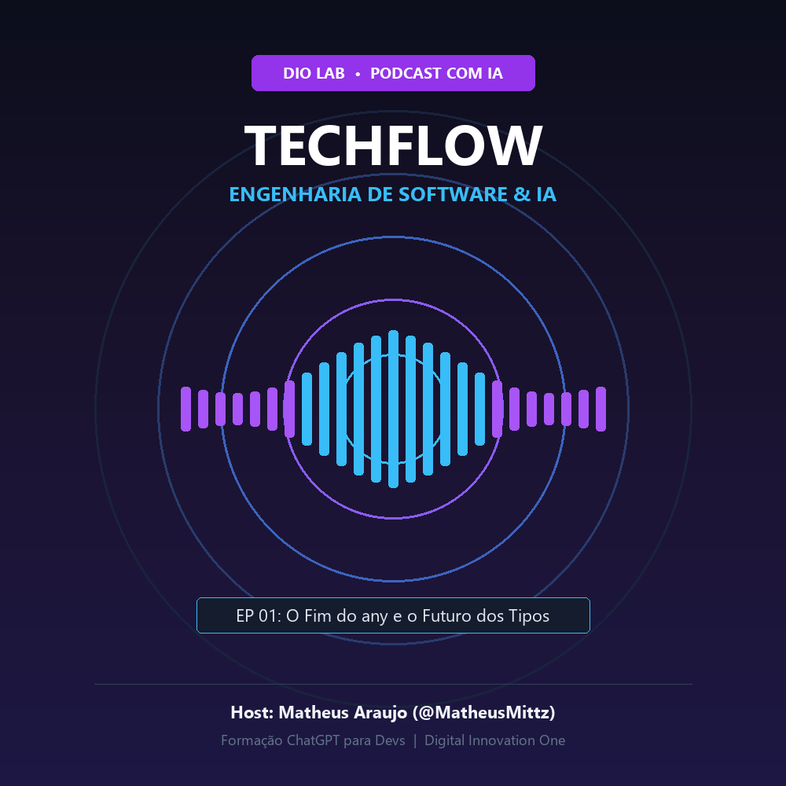

<p align="center">

</p>

<p align="center">
<a href="https://dio.me/">
    
</a>
<a href="https://openai.com/chatgpt">
    
</a>
<a href="https://midjourney.com/">
    
</a>
<a href="https://elevenlabs.io/">
    
</a>
</p>

---

## 🎧 Ouça o Episódio

<div align="center">
    <audio src="output/podcast_editado.MP3" controls title="Episódio 01 - O Fim do any e o Futuro dos Tipos"></audio>
</div>

<p align="center">
    <i>Episódio 01: O Fim do any e o Futuro da Tipagem Estrita com IA (Host: Matheus Araujo)</i>
</p>

---

# TechFlowcast: Podcast Criado com Inteligências Artificiais

> 📌 **Projeto prático** desenvolvido no laboratório **"Criando um Podcast com IAs"**, integrante da **Formação ChatGPT para Devs** na plataforma da [Digital Innovation One (DIO)](https://dio.me).

O objetivo deste projeto foi construir um episódio de podcast de ponta a ponta utilizando uma esteira integrada de ferramentas de Inteligência Artificial: desde o branding e roteirização até a síntese de voz neural, produção de arte de capa e edição final.

---

## 💻 Tecnologias e Ferramentas Utilizadas

| Ferramenta | Etapa no Pipeline | Finalidade |
| :--- | :--- | :--- |
| **[ChatGPT](https://chat.openai.com/)** | Roteirização | Ideação de nome, estrutura narrativa modular (intro, problema, solução, conclusão) e redação técnica |
| **[Midjourney](https://www.midjourney.com/)** | Identidade Visual | Direção de arte para capa quadrada 1:1 com temática cyberpunk e ondas sonoras |
| **[Edge-TTS / Neural Voices](https://github.com/rany2/edge-tts)** | Síntese de Voz | Conversão do roteiro em fala humanizada de estúdio em português com timbre neural |
| **[Python / Pillow (PIL)](https://python-pillow.org/)** | Diagramação | Renderização da capa oficial de alta resolução em proporção 1:1 |

---

## 🛠️ Pipeline de Criação

1. **Definição de Persona e Tema:** Foco em boas práticas de TypeScript e eliminação do uso de `any` em aplicações corporativas.
2. **Roteiro Estruturado:** Construção de prompt com blocos e variáveis para manter a locução direta, didática e dinâmica (1 a 2 minutos).
3. **Geração da Voz Neural:** Síntese de fala utilizando modelo neural em português brasileiro com ritmo natural e dicção limpa.
4. **Arte da Capa:** Design em proporção 1:1 (padrão Spotify/Apple Podcasts) com estética tech neon.

---

## 🤖 Prompts Utilizados

- 📝 **[Prompts de Ideação e Roteiro no ChatGPT](./src/prompts/chatgpt.md)**
- 🎨 **[Prompts de Direção de Arte no Midjourney](./src/prompts/midjourney.md)**

### Resumo dos Prompts Principais:

#### 1. Roteiro (ChatGPT)
```text
Você é um roteirista profissional de podcasts técnicos. Crie um roteiro dinâmico e direto ao ponto para o Episódio 01 do TechFlowcast, apresentado por Matheus Araujo, abordando:
- O perigo do "any" no TypeScript gerado desatentamente por IAs;
- Como usar Prompt Engineering para gerar contratos seguros de DTO e Utility Types;
- Dica de ouro final e chamada para ação nas redes.
```

#### 2. Capa (Midjourney)
```text
A modern tech podcast cover art, glowing futuristic studio microphone in center, neon soundwaves flowing in geometric circular patterns, vibrant purple and electric cyan colors on dark obsidian background, minimalist clean typography aesthetics, cyberpunk subtle lighting, 8k resolution, octane render, square aspect ratio --v 6.0 --ar 1:1
```

---

## 📁 Estrutura de Arquivos

```text
├── assets/
│   └── cover.png                  # Capa oficial do podcast (1000x1000 px)
├── output/
│   └── podcast_editado.MP3        # Áudio final narrado e sintetizado
├── src/
│   └── prompts/
│       ├── chatgpt.md             # Roteiro e prompts de texto
│       └── midjourney.md          # Prompts de imagem da capa
└── README.MD                      # Documentação completa do projeto
```

---

## 👨‍💻 Autor e Host

<p>
  
  <p>
    &nbsp;&nbsp;&nbsp;<b>Matheus Araujo</b><br>
    &nbsp;&nbsp;&nbsp;Desenvolvedor de Software & Host<br>
    &nbsp;&nbsp;&nbsp;
    <a href="https://github.com/MatheusMittz">GitHub</a>&nbsp;|&nbsp;
    <a href="https://www.linkedin.com/in/">LinkedIn</a>
  </p>
</p>
<br/><br/>

---

> Projeto desenvolvido por [Matheus Araujo](https://github.com/MatheusMittz) sob a tutoria de [Felipe Aguiar](https://github.com/felipeAguiarCode) na [DIO](https://dio.me).